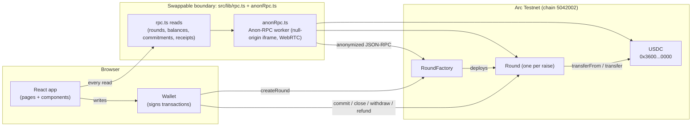

# Round — All-or-nothing USDC escrow for micro-raises

> **Micro-raises under $10,000, settled in USDC on Arc Testnet.**
> Backers commit USDC to a goal + deadline. The founder is paid only if the goal is hit; otherwise every backer gets a full refund that no admin can block.

---

## Table of contents

- [Round — All-or-nothing USDC escrow for micro-raises](#round--all-or-nothing-usdc-escrow-for-micro-raises)
  - [Table of contents](#table-of-contents)
  - [What it does](#what-it-does)
  - [Architecture](#architecture)
  - [Tech stack](#tech-stack)
  - [Deployed contracts (Arc Testnet)](#deployed-contracts-arc-testnet)
  - [Getting started](#getting-started)
    - [Prerequisites](#prerequisites)
    - [Install \& run](#install--run)
    - [Environment variables](#environment-variables)
    - [Circle CLI \& skills (optional, for agent workflows)](#circle-cli--skills-optional-for-agent-workflows)
  - [Project layout](#project-layout)
  - [Smart contracts](#smart-contracts)
    - [`Round.sol` — all-or-nothing escrow](#roundsol--all-or-nothing-escrow)
    - [`RoundFactory.sol` — registry](#roundfactorysol--registry)
  - [Frontend \& RPC model](#frontend--rpc-model)
  - [Circle / wallets / skills](#circle--wallets--skills)
  - [Testing](#testing)
  - [Forking \& contributing](#forking--contributing)
    - [Conventions](#conventions)
  - [Ideas for new features](#ideas-for-new-features)

---

## What it does

Round is a trust-minimized crowdfunding escrow for tiny raises (≤ $10,000 USDC). Each raise is its own `Round` contract, deployed permissionlessly by `RoundFactory`. There is **no owner, pause, upgrade, fee, or admin recovery** anywhere in the system.

- A founder opens a round with a title, funding target, per-backer cap, and deadline.
- Backers `commit` USDC before the deadline, up to their cumulative cap.
- At/after the deadline anyone calls `close()`, which flips the round to `Settled` (raised ≥ target) or `Refunded`.
- On `Settled`, only the creator can `withdraw()` the escrowed USDC (sweeps the full balance, including direct donations).
- On `Refunded`, each backer pulls their own commitment back via `refund()`.

The accounting invariant `usdc.balanceOf(this) >= totalRaised - totalRefunded` is checked on every mutating call, and stray tokens sent directly to the contract are swept to the creator only in the `Settled` state.

---

## Architecture



Key design choices:

- **One request per read.** Every export in `src/lib/rpc.ts` makes exactly one JSON-RPC request (a batch counts as one). Composed reads (e.g. a backer's position) are batched into a single round trip.
- **No viem `http()` client anywhere in `src/`.** wagmi's transport is a custom one layered over `anonRpc`, so all traffic is anonymized.
- **Decimals-agnostic contracts.** Contracts operate on raw token units; the 6-decimal USDC view is enforced only in the frontend via `@/onchain-money`.
- **Permissionless & trustless.** No admin keys, no upgrade proxy, no fees.

---

## Tech stack

| Layer | Technology |
| --- | --- |
| Frontend | React 18, Vite, TypeScript, Tailwind CSS |
| Web3 | wagmi v2, viem v2, ConnectKit |
| Contracts | Solidity 0.8.20, Foundry, OpenZeppelin 5.x |
| Chain | Arc Testnet (chain ID `5042002`), USDC as native gas + ERC-20 |
| RPC | Anon-RPC worker (`@anon-rpc/browser-harness` 0.4.0) |
| Wallets | injected (MetaMask, etc.) + Circle developer-controlled wallets for seeding |
| Toasts | Sonner |
| Package manager | Bun |

---

## Deployed contracts (Arc Testnet)

| Contract | Address |
| --- | --- |
| RoundFactory | [`0xd6c786d3eabddd791e9ad9554e56e808075a3a95`](https://explorer.testnet.arc.io/address/0xd6c786d3eabddd791e9ad9554e56e808075a3a95) |
| USDC (Arc) | `0x3600000000000000000000000000000000000000` |

Seeded rounds (real txs):

| Round | Outcome | Address |
| --- | --- | --- |
| Seed: goal reached | Settled, creator collected 2 USDC | [`0x6eCcA4D9aEfB9d38249b5a216099a238E8494F0C`](https://explorer.testnet.arc.io/address/0x6eCcA4D9aEfB9d38249b5a216099a238E8494F0C) |
| Seed: goal missed | Refunded, backer got 1 USDC back | [`0x0fEA5EFCe0466eBe460e82D0F6863dfA1508Ac04`](https://explorer.testnet.arc.io/address/0x0fEA5EFCe0466eBe460e82D0F6863dfA1508Ac04) |

---

## Getting started

### Prerequisites

- [Bun](https://bun.sh) ≥ 1.3
- [Foundry](https://getfoundry.sh) (forge/cast) ≥ 1.7
- Node 22 (for `@circle-fin/cli`)
- A browser wallet (MetaMask, Rabby, …) on Arc Testnet

### Install & run

```bash
git clone <your-fork>
cd round_escrow_for_micro_raises_6w9h19
bun install
cp .env.example .env   # then fill in values
bun run dev
```

### Environment variables

```bash
# .env
VITE_ROUND_FACTORY_ADDRESS=0xd6c786d3eabddd791e9ad9554e56e808075a3a95
CIRCLE_API_KEY=TEST_API_KEY:...          # Circle developer-controlled wallets
CIRCLE_ENTITY_SECRET=...                 # 32-byte hex
RPC_PROXY_BASE_URL=https://studio.arc.io # Anon-RPC proxy
```

### Circle CLI & skills (optional, for agent workflows)

```bash
npm install -g @circle-fin/cli
circle skill install --tool opencode     # or claude-code / cursor / codex
```

---

## Project layout

```
.
├── contracts/
│   ├── Round.sol                 # one raise
│   ├── RoundFactory.sol          # registry + deployer
│   └── test/*.t.sol              # 59 forge tests
├── src/
│   ├── App.tsx                   # router: /, /new, /round/:address
│   ├── config.ts                 # wagmi config (custom anonRpc transport)
│   ├── lib/
│   │   ├── contracts.ts          # chain, USDC, ABIs, factory address
│   │   ├── rpc.ts                # THE RPC adapter (one request per export)
│   │   ├── anonRpc.ts            # Anon-RPC worker singleton
│   │   ├── rpcStats.ts           # request counters
│   │   └── share.ts              # share-link helpers
│   ├── pages/                    # Home, NewRound, RoundPage
│   ├── components/               # RoundCard, RoundActions, CapTable, …
│   └── hooks/                    # react-query hooks + tx helper
├── scripts/                      # deploy, seed, fetch-abi, …
├── tests/                        # bun tests for rpc + format (31)
└── .agents/skills/               # Circle skills (installed)
```

---

## Smart contracts

### `Round.sol` — all-or-nothing escrow

```solidity
enum State { Open, Settled, Refunded }

function commit(uint256 amount) external nonReentrant;
function close() external;                       // anyone, after deadline
function withdraw() external nonReentrant;       // creator only, Settled
function refund() external nonReentrant;         // backer only, Refunded
function capTable() external view returns (address[] backers, uint256[] amounts);
function summary() external view returns (...);
```

- `commit` enforces the per-backer cap cumulatively and rejects non-standard (fee-on-transfer) tokens via a balance-delta check.
- `close` is permissionless and deterministic: `totalRaised >= target ? Settled : Refunded`.
- `withdraw` sweeps the full token balance (incl. direct donations) and asserts the contract is empty.
- `refund` is pull-based; each backer claims exactly their commitment.

### `RoundFactory.sol` — registry

```solidity
function createRound(string title, string metadataURI, uint256 target,
                    uint64 deadline, uint256 perBackerCap) external returns (address);
function allRounds() external view returns (address[] memory);
```

No admin, no fees, no upgrade. Rounds are independent contracts; the factory only records their addresses.

---

## Frontend & RPC model

All chain reads go through `src/lib/rpc.ts`, which uses `anonRpc` (never `viem`'s `http()` transport). Example:

```ts
// src/lib/rpc.ts
export async function roundSummary(round: Address): Promise<RoundData> {
  return toRoundData(round, await ethCall(round, summaryData))
}

// batched: many rounds in ONE request
export async function roundSummaries(rounds: Address[]): Promise<RoundData[]> {
  const raws = await ethCallBatch(rounds.map((to) => ({ to, data: summaryData })))
  return rounds.map((address, i) => toRoundData(address, raws[i]))
}
```

Writes are simulated first (`simulateWrite`) so a revert surfaces as a named custom error before the wallet opens:

```ts
await simulateWrite({ address: round, abi: roundAbi, functionName: 'commit', args: [amount] }, account)
// then send via wagmi's writeContract
```

---

## Circle / wallets / skills

This project leans on Circle's stack:

- **USDC on Arc** — native gas + ERC-20 at `0x3600…0000`, 6 decimals.
- **Developer-controlled wallets** — used by `scripts/seed-rounds.ts` to create Wallet A/B for seeded rounds.
- **Smart Contract Platform** — optional path for deploying/importing contracts via Circle APIs.
- **Circle skills** — installed in `.agents/skills/` (see `circle skill list`). Covers USDC, wallets, CCTP, x402, onramp.

---

## Testing

```bash
bun run test:rpc          # 31 bun tests (rpc + format)
bun run contracts:test    # 59 forge tests
bun run typecheck         # tsc --noEmit (see caveat below)
bun run lint              # oxlint
```

> Note: `forge` must be on `PATH` from `~/.foundry/bin`. `typecheck` has one pre-existing error in `scripts/compass-deploy.ts` (`@circlefin/compass-chains`), unrelated to app code.

---

## Forking & contributing

1. Fork the repo and create a feature branch.
2. Keep the RPC rule: every `rpc.ts` export makes exactly one request; never use `viem`'s `http()` in `src/`.
3. Keep contracts decimals-agnostic; format USDC with `@/onchain-money` (6 decimals).
4. Never commit secrets (`.env`, `.circle/`, recovery files, `*.pem`).
5. Run `bun run test:rpc` and `forge test` before opening a PR.
6. Open a PR describing the change and the test coverage.

### Conventions

- Components in `src/components/`, pages in `src/pages/`.
- Reads via `src/lib/rpc.ts`; writes via wagmi hooks in `src/hooks/`.
- Toasts via Sonner; styling via Tailwind + `src/index.css` tokens.

---

## Ideas for new features

- **CCTP bridge-in** — let backers bridge USDC from other chains into Arc to fund a round.
- **Fiat onramp** — "buy USDC" widget for non-crypto backers.
- **Circle custodial wallets** — smoother UX for round creation/funding.
- **x402 paid API** — expose round status as a pay-per-call endpoint.
- **Unified balance / Gateway** — pool USDC across chains for cross-chain backers.
- **Round templates** — recurring raises, milestones, stretch goals.
- **Notifications** — email/push when a round settles or refunds.
- **Indexer** — subgraph for faster round discovery beyond `eth_getLogs`.

---

Built with [Arc Studio](https://studio.arc.io).